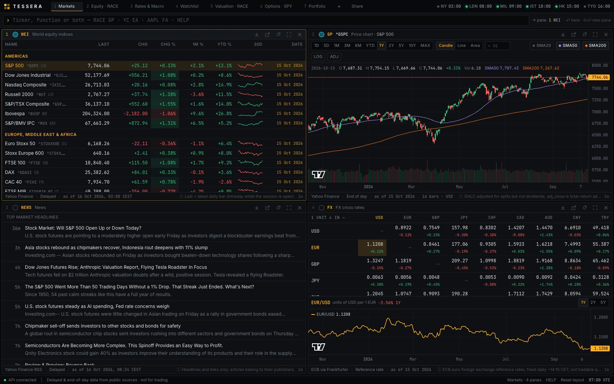
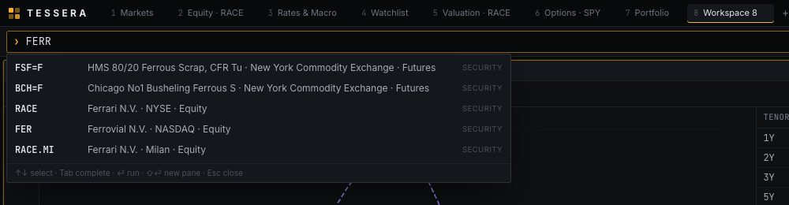
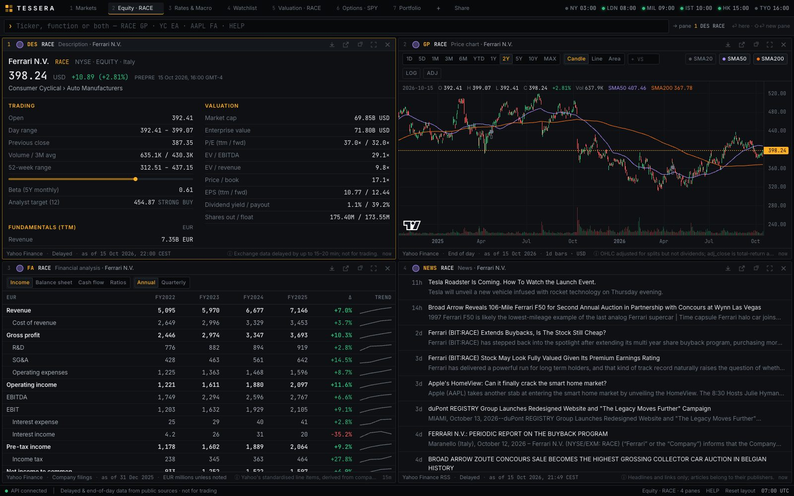
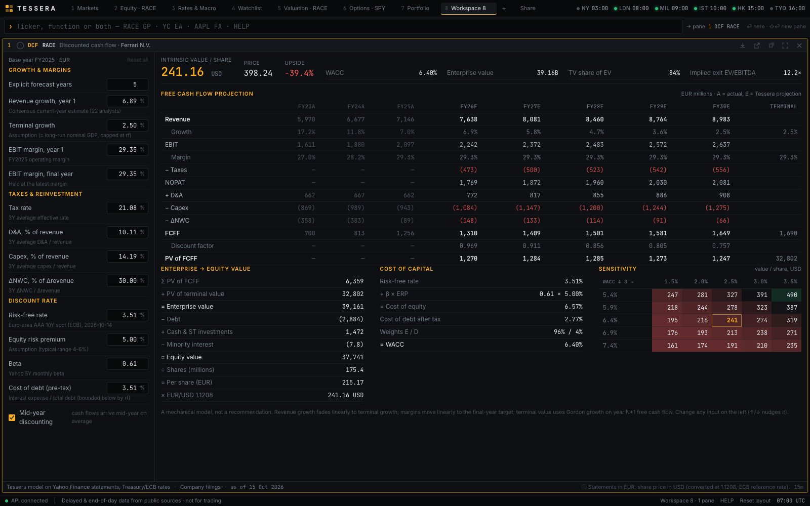
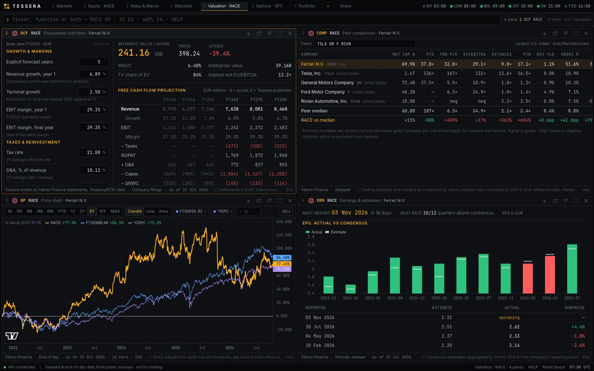
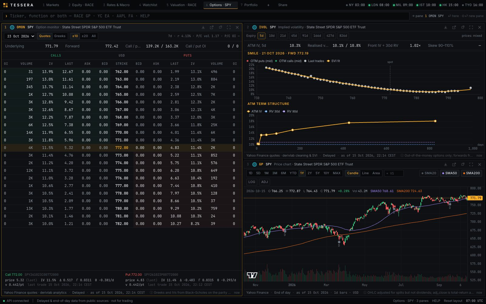
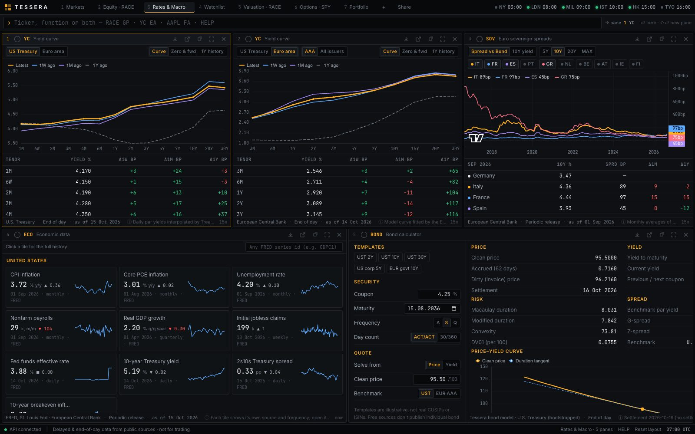
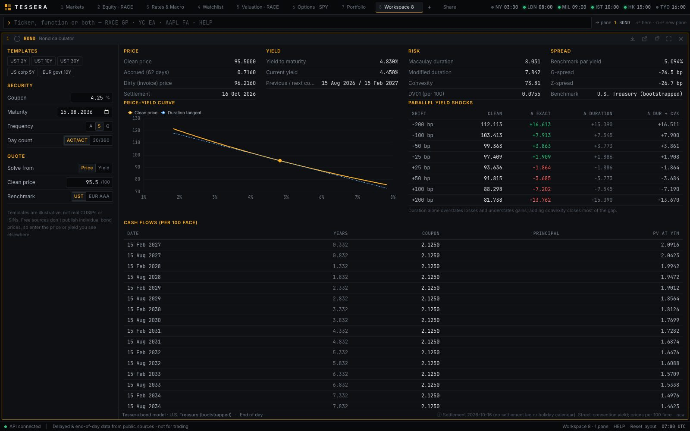
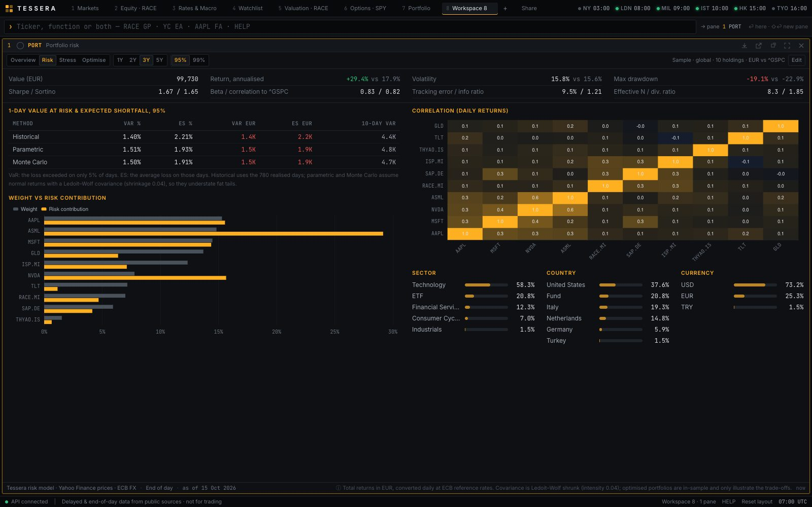
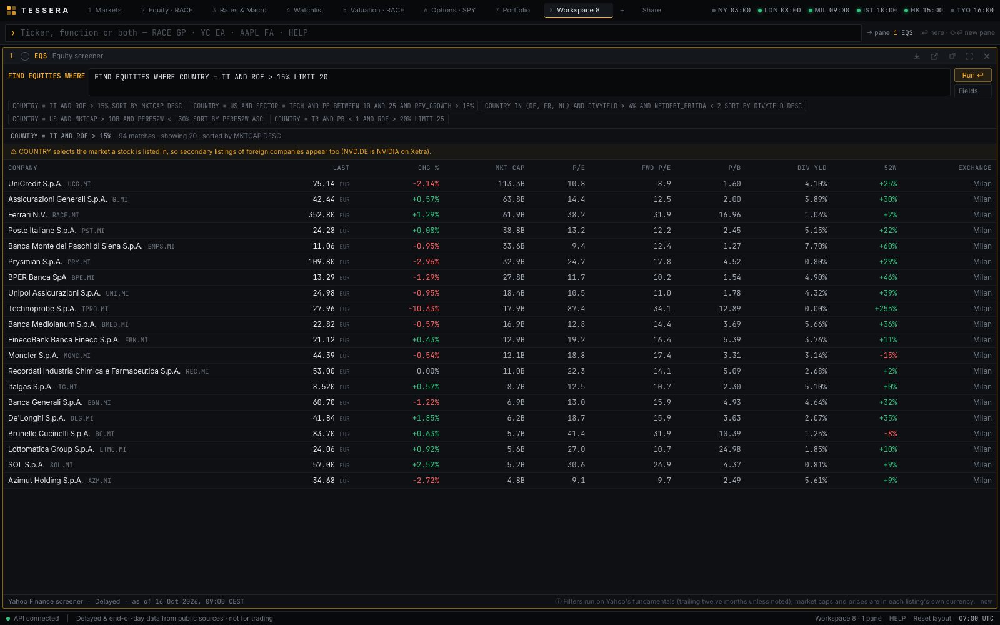

# Tessera

A **keyboard-first financial terminal in the browser**, inspired by the Bloomberg Terminal's
workflow and built entirely on free public data. Type a ticker and a function, and a pane fills
with a chart, a set of statements, a yield curve, an option chain or a portfolio's risk. Panes
tile, resize and link together. Every number on screen states where it came from and how fresh
it is.


> **Independent educational project.** Not affiliated with Bloomberg L.P. or any data provider,
> and not investment advice. Market data is delayed or end-of-day, from free sources, and is
> labelled as such everywhere; nothing is presented as real time, and nothing is fabricated.

The project is built around one question:

> **How close can a serious market terminal get when it is built only on free public data, and
> how do you keep it honest about what that data is?**

Answering it takes three things:
- **The workflow of a professional terminal:** a command line (`RACE GP`, `YC EA`,
  `AAPL FA BS Q`), tiled and linked panes, dense keyboard-driven screens and saved workspaces.
- **Breadth with real analytics:** equities, valuation, options, government bonds and curves,
  FX, macro, portfolio risk and screening — computed, tested and cross-checked, not just
  displayed.
- **Provenance on every number:** each pane's footer shows the source, the kind of data
  (delayed, end-of-day, reference rate, periodic release, filing), the as-of time and the
  method caveats. When a provider is down, the last good copy is served and marked **STALE**.

---

## Contents

- [Application overview](#application-overview)
- Areas: [The terminal](#1-the-terminal-command-line-panes-and-links) ·
  [Markets](#2-markets-and-monitoring) · [Company research](#3-company-research) ·
  [Valuation](#4-valuation) · [Options](#5-options) · [Rates, FX and macro](#6-rates-fx-and-macro) ·
  [Portfolio risk](#7-portfolio-risk) · [Screening](#8-screening) ·
  [AI assistant](#9-ask-an-ai-research-assistant)
- [Data and provenance](#data-and-provenance)
- [Correctness and validation](#correctness-and-validation)
- [Architecture](#architecture)
- [Technology](#technology)
- [Getting started](#getting-started)
- [API](#api)
- [Deployment](#deployment)
- [Methodological notes and limitations](#methodological-notes-and-limitations)
- [How the project was built](#how-the-project-was-built)

---

## Application overview

<p align="center">
  
</p>

The terminal has **26 functions** and opens on **seven preset workspaces**, one per workflow. Each
workspace is a tab of up to six panes; you can rename, add, rearrange and share them, and the
layout is saved in the browser.

| Workspace | Panes | Question it answers |
|---|---|---|
| **Markets** | WEI · GP · NEWS · FX | What is happening across world markets this morning? |
| **Equity · RACE** | DES · GP · FA · NEWS | What is this company, and how is it doing? |
| **Valuation · RACE** | DCF · COMP · GP compare · ERN | What is it worth, and how does it compare with its peers? |
| **Options · SPY** | OMON · IVOL · GP | What does the options market price in, and at which strikes and expiries? |
| **Rates & Macro** | YC US · YC EA · SOV · ECO · BOND | Where are government yields, spreads and the economy heading? |
| **Watchlist** | WL · GP · CMDTY | How are the securities and commodities I follow moving? |
| **Portfolio** | PORT · GP · DES | Where does my portfolio's risk come from, and how would it fare in a crisis? |

**All functions:**

| Area | Functions |
|---|---|
| Company research | `DES` description · `GP` price chart · `HP` historical prices · `FA` financial statements and ratios · `ERN` earnings and estimates · `DVD` dividends · `FIL` SEC filings · `NEWS` headlines |
| Valuation | `DCF` discounted cash flow · `COMP` peer comparison |
| Options | `OMON` option monitor · `IVOL` implied volatility |
| Markets | `WEI` world indices · `CMDTY` commodities · `MOST` movers · `WL` watchlist · `ALRT` price alerts · `EQS` screener |
| Rates, FX and macro | `YC` yield curves · `SOV` euro sovereign spreads · `BOND` bond calculator · `FX` cross rates · `ECO` economic data |
| Portfolio | `PORT` portfolio risk |
| Terminal | `ASK` AI research assistant · `HELP` function directory and shortcuts |

---

## 1. The terminal: command line, panes and links

<p align="center">
  
</p>

- **Command grammar:** `<TICKER>`, `<FUNCTION> [ARGS]`, or `<TICKER> <FUNCTION> [ARGS]`.
  - Enter runs the command in the active pane; Shift+Enter opens a new pane.
  - Autocomplete suggests functions, securities (live search), examples and recent commands.
  - Company names resolve to tickers: `ferrari` ⏎ loads RACE.
  - Start typing anywhere and the keystrokes go to the command line, as on a hardware terminal.
- **Panes:** up to six per workspace, tiled automatically and resizable; maximise, duplicate,
  close, **pop out into their own window** for a second monitor, or **export their tables as CSV**.
- **Link groups:** panes with the same colour follow each other. Click DAX in `WEI` and the
  linked chart switches to the DAX; type `ASML` into a linked `DES` and the chart, statements
  and news switch too.
- **Share:** copies a link that recreates the current workspace (layout and settings, no data).
- **Keyboard:** `Alt 1–6` focus a pane · `Alt M` maximise · `Alt N` duplicate · `Alt W` close ·
  `Alt L` link colour · `Alt [ ]` switch workspace · `/` or `Ctrl K` command line.
- **Status:** market clocks with open/closed dots (NY, London, Milan, Istanbul, Hong Kong,
  Tokyo), API connection, and a reset that restores the default workspaces.

## 2. Markets and monitoring

- **`WEI` world equity indices:** 25 indices in Americas, Europe/Middle East/Africa and Asia
  Pacific, plus VIX and the dollar index; last, change, 1-month and year-to-date moves, a
  30-day sparkline and a heat tint on the day's move. A date turns amber when a market has not
  traded yet today.
- **`CMDTY` commodities:** energy, metals and agriculture futures with their units (USD/bbl,
  USD/oz, USc/bu…).
- **`MOST` movers:** top U.S. gainers, losers and most active, with relative volume.
- **`WL` watchlist and `ALRT` price alerts:** your own list (add by ticker or name), and alerts
  that fire a toast and an optional desktop notification when a level is crossed.
- **`FX` cross rates:** a matrix of ECB reference rates with daily changes; click any cell for
  the pair's history.
- **`NEWS`:** headlines for a security or the market, with links to the publishers.

## 3. Company research

<p align="center">
  
</p>

- **`DES`:** quote, trading range, valuation multiples, trailing fundamentals, business summary
  and officers. It flags when the quote currency differs from the reporting currency (Ferrari
  trades in USD in New York but reports in EUR), a common source of wrong ratios.
- **`GP`:** candles, line or area; volume; 20/50/200-day moving averages; log scale; a
  dividend-adjusted (total-return) view; dividend and split markers; intraday bars in the
  exchange's local time. `RACE GP VS FTSEMIB.MI ^GSPC` compares performance, rebased to 0% at
  the left edge of whatever range is visible.
- **`HP`:** daily prices with period return, realised volatility and maximum drawdown.
- **`FA`:** income statement, balance sheet and cash flow (annual or quarterly), with
  period-on-period changes and trend sparklines, plus 17 derived ratios: growth, margins,
  returns, cash conversion, leverage and liquidity.
- **`ERN`:** next report date, EPS actual against consensus for recent quarters (beat rate),
  revenue and EPS estimates, and how the consensus moved over 90 days.
- **`DVD`:** dividend history, annual totals and growth, trailing yield, upcoming dates, splits.
- **`FIL`:** SEC EDGAR filings (10-K, 10-Q, 8-K, 20-F, 6-K…) linking to the original documents.

## 4. Valuation

<p align="center">
  
</p>

- **`DCF`:** a free-cash-flow-to-firm model built from the company's reported financials.
  - Every default assumption states its source: the consensus revenue estimate ("22 analysts"),
    three-year averages for margins, tax, D&A, capex and working capital, the 10-year yield in
    the reporting currency, Yahoo's beta.
  - Every assumption is editable (↑/↓ nudge it) and saved per pane.
  - Output: a projection next to the last three reported years, the enterprise-to-equity bridge,
    the cost of capital build-up, implied exit EV/EBITDA, and a WACC × terminal-growth
    sensitivity grid coloured against the current price.
  - It converts to the share price's currency when statements are in another one, and it refuses
    banks and insurers with an explanation: a cash-flow DCF does not fit businesses whose debt is
    their raw material.
- **`COMP`:** multiples, margins, returns and growth against the largest companies in Yahoo's
  industry (or your own list, `RACE COMP P911.DE STLA`), with peer medians and the target's
  premium or discount to them.

<p align="center">
  
</p>

## 5. Options

<p align="center">
  
</p>

Option analytics are computed by **derivlab**, the pricing library from the sibling project
[`05-derivatives-pricing-lab`](../05-derivatives-pricing-lab).

- **`OMON`:** calls and puts by strike for any listed expiry, centred on the at-the-money strike.
  - A quotes view (bid, ask, last, implied volatility, volume, open interest) and a Greeks view
    (Δ, Γ, Θ per day, ν per volatility point, and Yahoo's own IV for comparison).
  - The forward and implied carry come from put–call parity; IVs from a Brent solver; Greeks
    from the analytic Black–Scholes engine. Put/call volume and open-interest ratios.
- **`IVOL`:** up to eight expiries spread over the term structure.
  - The cleaned out-of-the-money smile (mid prices vs last trades) with an SVI fit, its error
    and butterfly-arbitrage flags, and the 90%/110% skew.
  - The at-the-money term structure against 30- and 90-day realised volatility.

## 6. Rates, FX and macro

<p align="center">
  
</p>

- **`YC` yield curves:** the U.S. Treasury par curve or the ECB's euro-area curve (AAA or all
  issuers), compared with 1 week, 1 month and 1 year ago, with 2s10s, 3m10y and 5s30s spreads.
  A **Zero & fwd** view bootstraps zero (spot) and 1-year forward curves.
- **`SOV` euro sovereign spreads:** 10-year yields for ten euro-area countries and their spread
  to the Bund (the BTP–Bund spread, Greece, Spain…), with 1-month and 1-year changes.
- **`BOND` bond calculator:** price ↔ yield on real dates.
  - Coupon schedules, accrued interest under ACT/ACT or 30/360, clean and dirty price.
  - Macaulay and modified duration, convexity, DV01, the cash flows with their present values.
  - G-spread and Z-spread to the Treasury or euro-area curve.
  - A parallel-shock table comparing the exact price change with the duration and
    duration-plus-convexity approximations, and the price–yield curve with its duration tangent.
- **`ECO` economic data:** a U.S. and euro-area dashboard (inflation, core PCE, unemployment,
  payrolls, GDP, claims, policy rates, 10-year yield, 2s10s, breakevens); any tile opens the full
  history, and any FRED series opens by its id (`ECO GDPC1`).

<p align="center">
  
</p>

## 7. Portfolio risk

<p align="center">
  
</p>

`PORT` analyses holdings in any mix of currencies (paste "TICKER SHARES" lines; the sample
portfolio mixes USD, EUR and TRY). Prices are converted into a base currency day by day at ECB
rates and use dividend-adjusted closes, so returns are total returns.

- **Overview:** value, annualised return and volatility against a benchmark in the same
  currency, Sharpe and Sortino ratios, maximum drawdown, beta, tracking error, information ratio,
  and each holding's weight against its **share of portfolio risk**.
- **Risk:**
  - one-day Value at Risk and Expected Shortfall three ways: historical, parametric and Monte
    Carlo;
  - Euler risk contributions, a correlation heatmap from a Ledoit–Wolf shrunk covariance;
  - sector, country and currency exposures, effective number of holdings and diversification
    ratio.
- **Stress:** five historical episodes replayed on today's weights (COVID crash, the 2022 rates
  shock, the SVB failure, the 2024 yen-carry unwind, the April 2025 tariff shock), plus
  benchmark and currency shocks.
- **Optimise:** equal-weight, minimum-variance and risk-parity alternatives from the same
  covariance, clearly labelled as in-sample.

## 8. Screening

<p align="center">
   15%, with the readable query, match count, a listing-country warning and results" width="95%">
</p>

`EQS` screens any market with a small query language that runs on Yahoo's server-side screener,
and works straight from the command line:

```text
FIND EQUITIES WHERE COUNTRY = IT AND ROE > 15% SORT BY MKTCAP DESC LIMIT 20
SECTOR = TECH AND PE BETWEEN 10 AND 25 AND COUNTRY IN (DE, FR, NL)
```

- About 30 fields across size, valuation, income, profitability, growth, balance sheet and
  positioning; AND / OR with parentheses, BETWEEN, IN, `2.5B`/`500M` and `15%` values,
  country names or codes, sector aliases.
- Errors point at the word that is wrong ("Unknown sector 'CONSUMER'. Sectors: …").
- Results warn about Yahoo's pitfalls: market caps are in each listing's own currency, and
  COUNTRY means where a stock is listed, so secondary listings appear (NVD.DE is NVIDIA on Xetra).

## 9. ASK: an AI research assistant

`ASK` answers questions in plain language using Tessera's own data, through Claude tool use:
`ASK How steep is the US curve compared with a year ago?` or, with a ticker for context,
`RACE ASK Is Ferrari expensive versus its peers?`

- The model may not state numbers from memory. Twelve tools wrap the same providers as the
  terminal's functions (profile, price history, statements, earnings, news, quotes, curves,
  sovereign spreads, macro series, FX, screener), every tool result carries its source and date,
  and the answer must cite them.
- Each answer shows **how it was answered**: every tool call with its arguments, source and date,
  and an **Open** button that shows the same data in the matching function, so any figure can be
  checked.
- It needs an Anthropic API key (`ANTHROPIC_API_KEY`); without one it explains how to configure
  it. Each question costs a few cents of API usage, and a question is sent exactly once.

---

## Data and provenance

| Source | Used for | Nature |
|---|---|---|
| Yahoo Finance (via `yfinance`, RSS, screener) | Equities, indices, futures, statements, estimates, options, news, screening | Delayed / end of day; unofficial API for personal and educational use |
| U.S. Treasury | Daily par yield curve | Official, end of day |
| European Central Bank Data Portal | Euro-area curves, sovereign 10-year yields, euro-area macro | Official; curves daily, sovereign yields monthly |
| FRED (St. Louis Fed) | U.S. and euro-area macro series | Official releases, revised over time |
| Frankfurter (mirror of the ECB fixings) | FX reference rates; currency conversion | One reference fixing per business day, not tradable quotes |
| SEC EDGAR | Company filings | Official; needs a contact User-Agent (`SEC_USER_AGENT`) |

- **Every API response is `{data, meta}`**, where `meta` is the provenance record: source, a link
  to verify it, freshness, as-of time, retrieval time, a stale flag and method notes. The UI
  prints it under every pane.
- **Caching with a stale fallback:** provider responses are cached in memory and on disk, with
  lifetimes matched to the data (90 seconds for quotes, hours for statements). If a provider
  fails, the last good copy is served and marked **STALE**, so a demo keeps working offline
  without pretending the data is current.
- **Derived numbers are computed in one visible place** (year-over-year changes, spreads, cross
  rates, ratios) and say so ("computed by Tessera").

---

## Correctness and validation

Analytics are tested against independent references, not only against themselves.

| Area | Reference | What is checked | Tolerance |
|---|---|---|---|
| Bonds | **QuantLib** | Clean price, accrued interest, Macaulay and modified duration, convexity, for six bonds (ACT/ACT and 30/360, annual to quarterly, end-of-month, zero coupon) | 1e-8 price · 1e-9 accrued · 1e-6 relative risk |
| Bonds | Self-consistency | Yield ↔ price round trip; DV01 against a 1bp bump | 1e-10 · 1e-6 relative |
| Curves | Exact identity | The bootstrapped curve reprices every par bond | 1e-12 |
| Covariance | **scikit-learn** | Ledoit–Wolf shrinkage intensity and covariance | 1e-9 relative |
| Options | Hull's textbook value | Implied-vol round trip on a 10.4506 ATM call | 1e-8 |
| Options | Synthetic Heston chain | Cleaning → SVI fit error and the sign of the equity skew | RMSE < 1 vol point |
| DCF | Hand calculation | Projection, terminal value, enterprise and equity value, mid-year convention | 1e-6 relative |
| Risk | Closed forms | Minimum variance and risk parity on two assets; Monte Carlo VaR → parametric VaR | 1e-6 · 2% |

**Other checks (105 backend tests, 15 frontend tests):**
- **Parsers on recorded payloads:** Treasury and ECB CSVs, FRED series, RSS, SEC submissions,
  Yahoo statement frames; dividend totals; the minor-currency (pence) conversion.
- **Model guards:** the DCF refuses banks; WACC must exceed terminal growth; a missing derivlab
  or API key returns a clear configuration error instead of a crash.
- **The query language:** precedence, BETWEEN/IN, number suffixes, helpful errors and warnings.
- **The command grammar, share links (sanitised on import) and CSV export** (vitest).
- **The AI loop with a scripted client:** parallel tool calls and their trace, refusals, the
  step budget, missing credentials.
- **A Playwright smoke test** (`make e2e`) walks every workspace and function in Chrome and fails
  on any console or HTTP error. It edits a DCF assumption, switches OMON to Greeks, edits a
  portfolio, downloads a CSV, triggers an alert, opens a pop-out and imports a share link.

---

## Architecture

```
frontend/   React + TypeScript ──── fetch /api/* ────▶  backend/src/tessera_api/   FastAPI routes
            workspace state, panes,                       │  validation, HTTP errors, rate limit
            charts, command grammar                       ▼
                                                     backend/src/tessera/        analytics + providers
                                                          │
                                       ┌──────────────────┼───────────────────────┐
                                       ▼                  ▼                       ▼
                                 providers/          pure analytics          derivlab (project 05,
                                 Yahoo, Treasury,    dcf, bonds, curves,     optional): option
                                 ECB, FRED, FX, SEC  risk, screener          IVs, Greeks, SVI
```

- **Providers** turn each source into typed Pydantic models and wrap them in a provenance
  `Envelope`, behind the read-through cache.
- **Pure analytics** (`dcf.py`, `bonds.py`, `curves.py`, `risk.py`, the screener parser) contain
  no I/O, so they are tested offline against references; workflow modules (`valuation.py`,
  `fixed_income.py`, `options.py`, `portfolio.py`, `assistant.py`) assemble them with data.
- **The frontend** keeps one function per file and one pane model (`function, security, params,
  link`); adding a function means a registry entry, its arguments in the command grammar and a
  component.

```text
06-financial-terminal/
├── backend/
│   ├── src/tessera/
│   │   ├── providers/       # yahoo, research (estimates, peers, movers), rates, macro, fx, sec, ecb
│   │   ├── dcf.py  valuation.py              # DCF model · inputs, defaults with sources, peers
│   │   ├── bonds.py  curves.py  fixed_income.py   # bond maths · par/zero/forward · workflows
│   │   ├── risk.py  portfolio.py             # risk maths · portfolio analysis
│   │   ├── options.py  option_models.py      # OMON/IVOL via derivlab · response models
│   │   ├── screener.py  assistant.py         # query language · ASK tool loop
│   │   └── cache.py  models.py  markets.py   # cache · provenance envelope · monitors
│   ├── src/tessera_api/main.py               # FastAPI app; serves the built UI
│   └── tests/                                # offline; QuantLib and scikit-learn as references
├── frontend/src/
│   ├── functions/           # one file per function + registry.ts (codes, syntax, help)
│   ├── components/          # top bar, command line, tiling workspace, pane chrome, alerts
│   ├── charts/              # Lightweight Charts (time series), ECharts (curves, heatmaps)
│   ├── state/               # Zustand workspace store (persisted, versioned migrations), toasts
│   ├── lib/                 # command grammar, formatting, share links, CSV
│   └── api/                 # typed client and TanStack Query hooks
├── e2e/                     # Playwright smoke test, README screenshots
├── docs/screenshots/
├── Dockerfile  .github/workflows/ci.yml
├── AGENTS.md                # detailed architecture, conventions and roadmap
└── Makefile
```

---

## Technology

| Layer | Stack |
|---|---|
| Backend | Python 3.13, FastAPI, Pydantic v2, pandas, NumPy, SciPy, httpx, yfinance |
| Option analytics | derivlab (project 05) |
| AI assistant | Anthropic Python SDK (Claude tool use) |
| Frontend | React 19, TypeScript 6, Vite 8, Tailwind CSS v4, TanStack Query, Zustand, react-resizable-panels |
| Charts | TradingView Lightweight Charts (time series), Apache ECharts 6 (curves, smiles, heatmaps) |
| Quality | pytest, QuantLib and scikit-learn (reference oracles), vitest, ruff, pyright, oxlint, Prettier, Playwright |
| Delivery | Docker (single container), GitHub Actions CI |

---

## Getting started

Requirements: **Python 3.12–3.13**, **Node 20+**, and Google Chrome for the browser tests. The
option functions (`OMON`, `IVOL`) also need the sibling project `../05-derivatives-pricing-lab`;
without it everything else works and those two explain what is missing.

```bash
make install           # backend virtualenv (+ derivlab if present), npm packages
cp .env.example .env   # optional settings, see below
make dev               # API on :8010 (auto-reload) + web app on :5180
```

Open **http://localhost:5180** and start on the **Markets** tab, or type `HELP`. The ports differ
from the other QuantProjects (8000/5173) so they can run side by side
(`make dev API_PORT=… WEB_PORT=…` to change them).

| Setting (`.env`) | Purpose |
|---|---|
| `SEC_USER_AGENT` | Contact string SEC EDGAR requires, e.g. `"Your Name you@example.com"` — enables `FIL` |
| `ANTHROPIC_API_KEY` | Enables `ASK`; `TESSERA_ASK_MODEL` overrides the model (default `claude-opus-5-5`) |
| `TESSERA_RATE_LIMIT` | API requests per minute per client (default 300; 0 disables) |
| `TESSERA_CACHE_DIR` · `TESSERA_STATIC_DIR` | Where provider responses are cached · where the built UI is served from |

| Command | What it does |
|---|---|
| `make test` | Backend (pytest) and frontend (vitest) tests, offline |
| `make lint` | ruff, pyright, TypeScript, oxlint, Prettier |
| `make check` | lint + tests + production build |
| `make e2e` | Playwright smoke test over every workspace and function (needs `make dev` running) |
| `make readme-shots` | Re-capture the screenshots in this README |
| `make serve` | Build the UI and serve everything from FastAPI on :8010 |

---

## API

29 JSON endpoints under `/api`; interactive documentation is at **http://localhost:8010/docs**.
Every response is `{data, meta}` with the provenance record in `meta`.

| Area | Endpoints |
|---|---|
| Securities | `search` · `securities/profile` · `securities/history` · `securities/financials` · `securities/earnings` · `securities/dividends` · `securities/filings` · `news` |
| Valuation | `valuation/dcf/inputs` · `valuation/dcf` (POST) · `valuation/comps` |
| Options | `options/chain` · `options/surface` |
| Markets | `quotes` · `monitors/{WEI,CMDTY}` · `movers` · `screen` · `screen/fields` |
| Rates, FX, macro | `rates/curve` · `rates/curve-analytics` · `rates/sovereign` · `bonds/analyze` (POST) · `fx/matrix` · `fx/history` · `macro/dashboard` · `macro/series` |
| Portfolio · AI | `portfolio/analyze` (POST) · `ask` (POST) |
| Service | `health` |

---

## Deployment

```bash
make docker       # one image: built UI + API; build context is the QuantProjects folder
make docker-run   # http://localhost:8010, provider cache kept in the `tessera-data` volume
```

- The image builds the UI with Node, installs Tessera and derivlab on `python:3.13-slim`, runs as
  a non-root user with a health check, and keeps its cache in a volume.
- The API compresses responses (ten years of daily prices: 433 kB → 84 kB), sets basic security
  headers and rate-limits each client, so a public instance cannot exhaust the free providers.
- CI (`.github/workflows/ci.yml`) lints, type-checks, tests and builds both halves on every push.

---

## Methodological notes and limitations

- **Free data has limits.** Yahoo Finance is an unofficial API whose fields can change; quotes
  are delayed and Yahoo's terms allow personal and educational use. Analyst estimates and peer
  lists are Yahoo's. Individual bond prices are not freely available, so `BOND` takes the price
  or yield you enter.
- **Not point-in-time.** Financial statements are Yahoo's standardisation and restated figures
  replace the originals, so the history is not what an investor saw at the time.
- **Coarse series:** euro-area sovereign yields are monthly averages; FX rates are one daily
  reference fixing; market clocks ignore holidays.
- **Models are simplifications:**
  - the DCF is a mechanical model whose output depends entirely on its assumptions (the UI shows
    each one's source and a sensitivity grid);
  - option IVs and Greeks use the European Black–Scholes model on American-style options, which
    is standard for out-of-the-money options and approximate deep in the money;
  - bond maths has no settlement lag or holiday calendar, and supports ACT/ACT and 30/360 only;
  - Value at Risk by the parametric and Monte Carlo methods assumes normal returns and
    understates fat tails; optimised portfolios are in-sample.
- **Cross-market statistics:** daily returns of markets that close at different times correlate
  less than they should, so betas of European holdings against a U.S. benchmark are understated.
- **Screening pitfalls:** sizes are in each listing's own currency, and COUNTRY selects the
  listing's market, not the company's home (both are flagged in the results).
- **AI output is generated text.** Every figure is cited and traceable to a tool call; check
  them with Open. `ASK` has so far been tested with a scripted client, not against the live API.
- **Not yet exercised here:** the Docker image has not been built on the development machine,
  and CI runs once the repository is on GitHub.

---

## How the project was built

The terminal was built in phases. Each ended with tests, a browser smoke test, updated docs and a
commit:

| Phase | Scope |
|---|---|
| MVP | Command line, tiled and linked panes, workspaces; DES, GP, HP, FA, NEWS, FIL, WEI, CMDTY, WL, FX, YC, SOV, ECO; provenance envelope and stale cache |
| 1 · Equity depth | DCF with sourced assumptions, peer comparison, relative-performance charts, earnings, dividends, movers |
| 2 · Options | Option monitor and implied-volatility smile, reusing project 05's derivlab |
| 3 · Fixed income | Date-based bond calculator validated against QuantLib; bootstrapped zero and forward curves |
| 4 · Portfolio | Multi-currency portfolio risk: VaR/ES, risk contributions, stress replays, optimisation |
| 5 · Screening and workflow | Query-language screener, price alerts, CSV export, pop-out panes, share links |
| 6 · Platform | Optional derivlab, Docker image, CI, compression, rate limiting |
| 7 · AI | ASK: a cited research assistant over the terminal's own data |

Next steps are listed in `AGENTS.md`: deployment, point-in-time storage of history, saved
screens, and an evaluation set for `ASK`.

---

## Purpose

This project is part of a broader quantitative-finance portfolio (`01` stock explorer → `05`
derivatives pricing lab). Where the earlier projects each go deep on one question, Tessera brings
them together in the shape of the tool professionals actually use, and asks what it takes to
make that tool trustworthy:
- **workflow** — finding, linking and comparing information fast;
- **analytics** — valuation, rates, options and risk that are tested against references;
- **honesty** — data that says where it came from, how old it is and what it cannot tell you.

The central lesson: **a terminal is only as good as the data behind it, so show the source of
every number and the limits of every model.**
